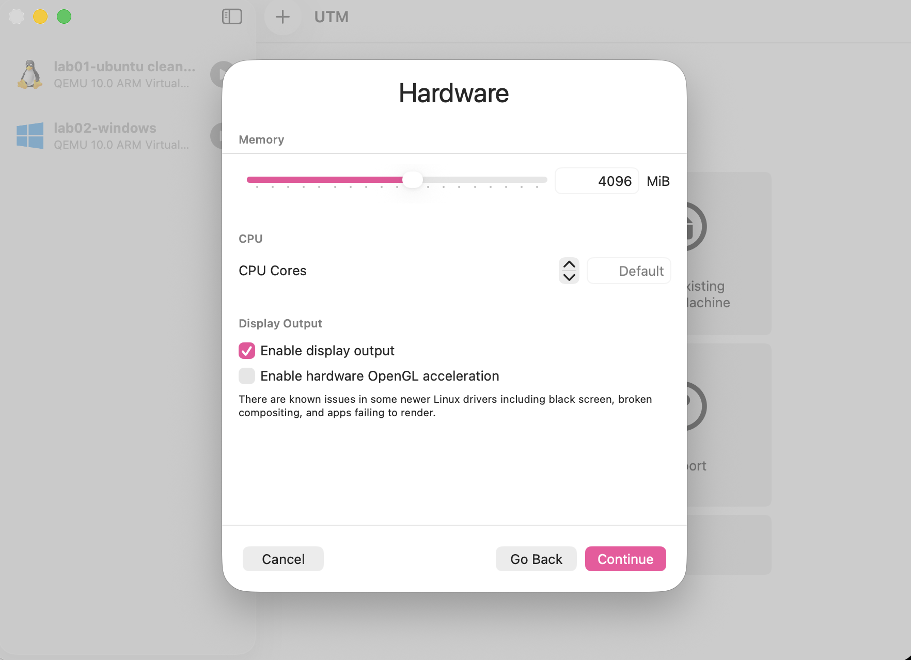
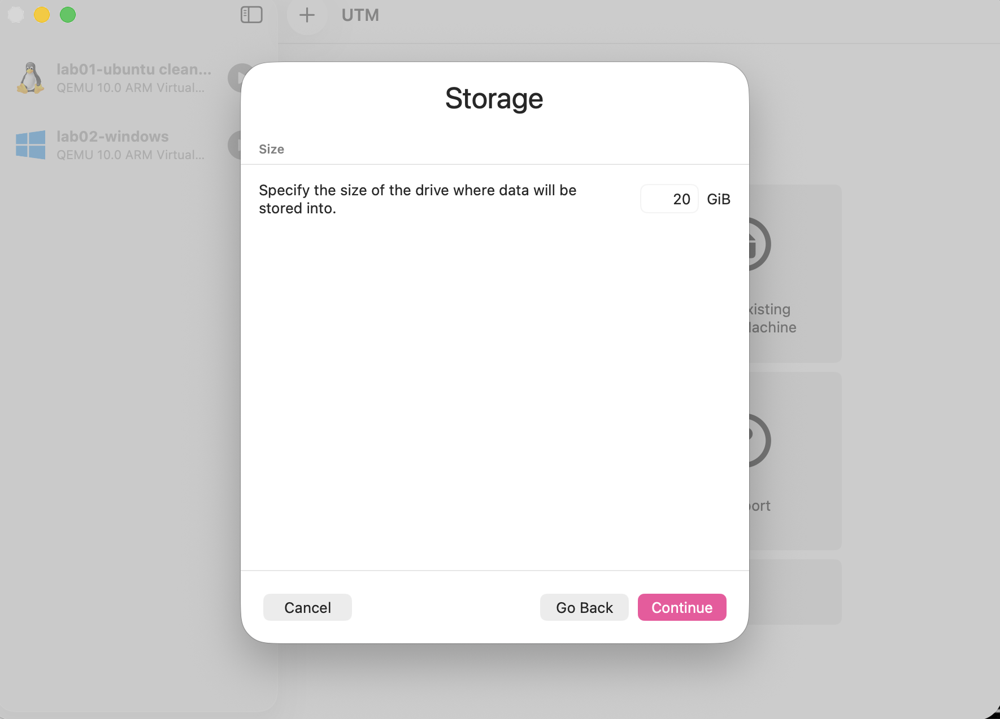
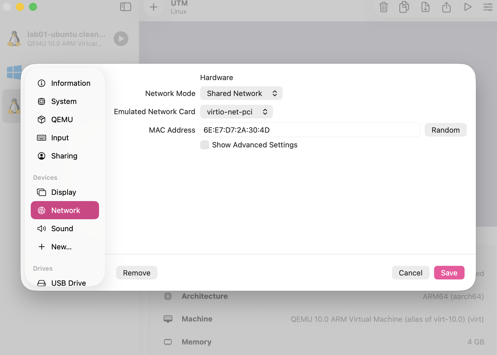

# BUILD Instructions: Linux & Windows Test VMs (UTM on Apple Silicon)

### Step 1: Create New VM Wizard
Open UTM, click the '+' icon, select "Virtualize", and choose Linux.

*Reasoning: We select Virtualize to leverage native Apple Silicon hardware acceleration for optimal performance.*

### Step 2: Disk Allocation
Specify the size of the drive where data will be stored (set to 20 GiB).

*Reasoning: Dynamic disk allocation ensures space is only used on the host SSD when actual data is written.*

### Step 3: Network Configuration
Configure the network adapter hardware settings to Shared Network.

*Reasoning: Shared Network allows virtual machines to access the internet while retaining local IP connectivity between guest VMs.*

### Step 4: Verification and Evidence Capture
Run system diagnostic commands and save evidence to the `/evidence` folder.
