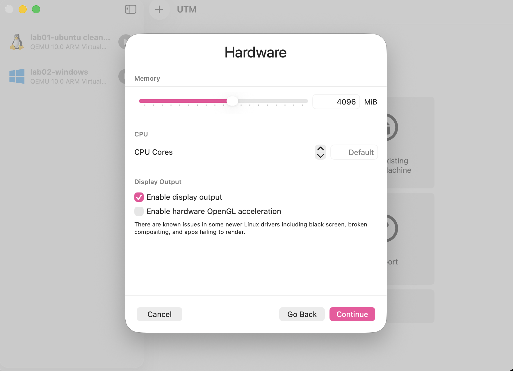
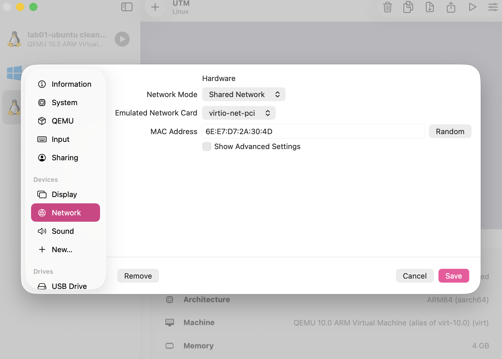

# Ticket 1 – "New developer starts Monday, needs a test machine"

## 1. What was asked
From: Algerin T. (Office Manager)
Subject: test machine for new dev

Hi, we have someone starting on Monday and he needs a test computer set up. Nothing special, just so he can try things without breaking anything. Can you write down how to do it so I can do the next one myself? Thanks

## 2. What was actually needed
The request asked for a basic test computer without specifying the operating system, resource limits, or architecture. What was actually needed:
- Deployment of two isolated virtual machines (Linux Ubuntu ARM64 and Windows 11 ARM64) on Apple Silicon (M5 Pro host).
- Allocation of host resources (4 GB RAM for Linux, 6 GB RAM for Windows out of 24 GB total RAM).
- Internal network configuration to allow host-to-guest and guest-to-guest communication with internet access.
- A fully documented, step-by-step build guide (BUILD.md) tailored for a non-technical user.

## 3. What I did
1. Installed UTM hypervisor on macOS (Apple Silicon).
2. Created a Linux VM (Ubuntu ARM64) with 4 GB RAM and 20 GB disk space.
3. Created a Windows 11 VM (ARM64) with 6 GB RAM and 30 GB disk space.
4. Configured shared virtual network adapters for both guests.
5. Tested connectivity between guests using ping and verified system specs with uname -a.
6. Took VM snapshots for recovery.

## 4. Evidence
# BUILD Instructions: Linux & Windows Test VMs (UTM on Apple Silicon)

### Step 1: Create New VM Wizard
Open UTM, click the '+' icon, select "Virtualize", and choose Linux.

*Reasoning: We select Virtualize to leverage native Apple Silicon hardware acceleration for optimal performance.*

### Step 2: Disk Allocation
Specify the size of the drive where data will be stored (set to 20 GiB).

*Reasoning: Dynamic disk allocation ensures space is only used on the host SSD when actual data is written.*

### Step 3: Network Configuration
Configure the network adapter hardware settings to Shared Network.

*Reasoning: Shared Network allows virtual machines to access the internet while retaining local IP connectivity between guest VMs.*

### Step 4: Verification and Evidence Capture
Run system diagnostic commands and save evidence to the `/evidence` folder.

## 5. What I would do differently
Next time, I would automate the VM deployment process using CLI tools like `utmctl` or Vagrant scripts instead of performing manually guided installation via GUI.
